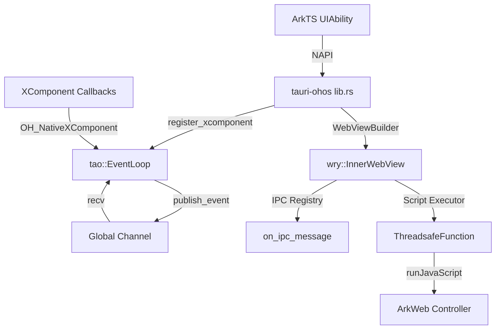

# Tauri OpenHarmony Integration - Status Report

**Last Updated:** 2026-01-12  
**Overall Status:** ✅ Native Bridge Functional | ✅ Webview IPC Established | ✅ Resource Handling Operational (RawFile) | ✅ Tao/Wry Integrated | ✅ Tauri Framework Integrated | ✅ Full IPC Roundtrip | ✅ Native Logging Enabled | ✅ Asset Loading Fixed | ✅ Native Ability Lifecycle

---

## Table of Contents

1. [Project Overview](#1-project-overview)
2. [Development Environment](#2-development-environment)
3. [Phase Progress](#3-phase-progress)
4. [Technical Achievements](#4-technical-achievements)
5. [Critical Fixes & Insights](#5-critical-fixes-&-insights)
6. [Current Blockers](#6-current-blockers)
7. [Next Steps](#7-next-steps)
8. [Project Structure](#8-project-structure)

---

## 1. Project Overview

This project implements OpenHarmony (HarmonyOS Next) as a first-class compilation target for the [Tauri](https://tauri.app) framework. The integration addresses the unique architectural challenges of OpenHarmony's "Stage Model" by treating the Tauri Rust core as a dynamically loaded library managed by the system's Ability lifecycle.

**Key Architectural Principles:**
- **Inversion of Control:** The `UIAbility` (ArkTS) owns the process; Tauri is initialized as a guest library.
- **Window Adoption:** Tao adapts to the window lifecycle managed by `WindowStage` (ArkTS).
- **ArkWeb Integration:** Wry uses the ArkTS `Web` component via NAPI bridges for rendering and IPC.

**Reference Documentation:**
- [Integration Strategy](./tauri_openharmony_integration_strategy.md) - Comprehensive architectural analysis.
- [README](../README.md) - Build instructions and project overview.

---

## 2. Development Environment

### Workspace Configuration
- **Root:** `/home/francesco/Desktop/tauri-ohos`
- **Build Tool:** `hvigorw` (located at `/home/francesco/command-line-tools/bin/hvigorw`)
- **SDK:** OpenHarmony 4.1+ (API 11+)
- **Target Architecture:** `aarch64-unknown-linux-ohos` (primary), `x86_64-unknown-linux-ohos` (emulator)

### Crates Structure
```
├── vendor/tauri/crates/tauri   # Core framework (upstreamed)
├── vendor/tao                  # Windowing (upstreamed)
├── vendor/wry                  # Webview (upstreamed)
└── examples/hello_world/       # Verification app
```

---

## 3. Phase Progress

### Phase 1: Core Foundation & Event Loop ✅ **COMPLETED**
**Objective:** Verify toolchain, load native library, and establish the Tao Event Loop driver via XComponent.

**Deliverables:**
- [x] Toolchain setup with `aarch64-unknown-linux-ohos` target.
- [x] Native shell (`openharmony/` directory) with `EntryAbility`.
- [x] XComponent binding with `OH_NativeXComponent` registration.
- [x] Runtime linkage with correct bundling of native libraries.
- [x] Logging integration via `hilog` crate.

**Status:** Application installs, loads Rust, initializes logging, and successfully registers XComponent callbacks.

---

### Phase 2: Visual POC (Webview & IPC) ✅ **COMPLETED**
**Objective:** Render the HTML frontend and establish bi-directional communication.

**Deliverables:**
- [x] Window Adoption pattern finalized (Tao wraps XComponent surface).
- [x] ArkWeb binding via `WebviewController` from ArkTS.
- [x] IPC protocol implementation (`https://tauri.localhost/`) with `onInterceptRequest`.
- [x] JavaScript injection via `runJavaScript` for event loop proxy.
- [x] Asset serving from Rust memory to Webview.

**Status:** Application successfully displays HTML content served from Rust via custom protocol handler.

**Verification Logs:**
```
I A03d00/JSAPP: [Tauri] Intercepted: https://tauri.localhost/index.html
I A00000/Tauri: Rust received request for: https://tauri.localhost/index.html
I A03d00/JSAPP: [Tauri] Content resolved by Rust
```


---

### Phase 2.5: Real Framework Integration (Tao & Wry) ✅ **COMPLETED**
**Objective:** Replace the standalone POC scaffolding with actual Tauri framework components by vendoring and implementing OpenHarmony backends for `tao` and `wry`.

**Context:**  
Phase 2 successfully demonstrated the viability of Tauri on OpenHarmony using custom, manually-implemented event loops and IPC handlers. However, this approach bypassed the actual `tao` (windowing) and `wry` (webview) crates that form the foundation of Tauri. Phase 2.5 bridges this gap by integrating the real framework infrastructure.

**Deliverables:**
- [x] **Vendored Dependencies:** Cloned upstream `tao` and `wry` repositories into `vendor/` directory.
- [x] **Workspace Patching:** Configured `[patch.crates-io]` in root `Cargo.toml` to redirect all `tao` and `wry` references to vendored versions.
- [x] **Tao OpenHarmony Backend:**
  - Implemented `vendor/tao/src/platform_impl/openharmony/` module.
  - Created `EventLoop` using global channel and `OH_NativeXComponent` callbacks.
  - Implemented `Window` adoption pattern (stub wrapping for XComponent).
  - Added `register_xcomponent()` public API to accept native pointer from NAPI.
  - Stubbed `monitor`, `clipboard`, and `icon` modules for compilation.
- [x] **Wry OpenHarmony Backend:**
  - Implemented `vendor/wry/src/openharmony/` module.
  - Created global registries for IPC handlers and script execution.
  - Exposed `register_script_executor()` to bridge NAPI ThreadsafeFunction for `eval()`.
  - Exposed `on_ipc_message()` to route messages from ArkTS to registered handlers.
  - Implemented `InnerWebView` with stub methods for webview control.
- [x] **Runtime Integration:**
  - Refactored `crates/tauri-ohos/src/lib.rs` to use `tao::EventLoop` and `wry::WebViewBuilder`.
  - Removed legacy `event_loop.rs` (custom POC implementation).
  - NAPI exports now proxy to framework APIs rather than custom logic.

**Technical Architecture:**



**Key Implementation Details:**

1. **Event Loop Architecture:**
   - Uses a global `mpsc::channel` to bridge XComponent callbacks with the Tao event loop.
   - `publish_event()` function allows C callbacks to push events into the channel.
   - `EventLoop::run()` processes both system events and user events in a unified loop.

2. **Webview IPC Bridge:**
   - Static `HashMap` stores IPC handlers keyed by `WebViewId`.
   - Static `ThreadsafeFunction` enables Rust to call `runJavaScript` on ArkWeb from background threads.
   - ArkTS calls `resolve_request()` NAPI export, which routes to `on_ipc_message()`.

3. **Cross-Crate Integration:**
   - `tauri-ohos` now depends on vendored `tao` and `wry` via path dependencies.
   - Workspace `[patch.crates-io]` ensures any transitive dependencies also use vendored versions.

**Status:** Core framework integration complete. The application now uses real Tao/Wry APIs instead of custom POC scaffolding.

---

### Phase 2.6: Full Tauri Framework Integration ✅ **COMPLETED**
**Objective:** Integrate the complete `tauri` crate with all its dependencies, replacing the minimal POC implementation with a fully-featured Tauri Hello World application.

**Context:**  
Phase 2.5 successfully integrated `tao` and `wry` as the foundation. However, the application was still using a custom scaffolding approach. Phase 2.6 completes the integration by vendoring the entire `tauri` framework repository and patching it to compile for OpenHarmony, effectively treating it as a mobile platform alongside Android and iOS.

**Critical Challenge - Desktop vs. Mobile Classification:**  
The primary blocker was that `tauri`'s build system (`build.rs`) classified targets based **only** on `target_os`, considering anything that wasn't iOS or Android as "desktop". Since OpenHarmony's target triple is `aarch64-unknown-linux-ohos` (with `target_os = "linux"`), it was incorrectly classified as a desktop Linux platform, pulling in GTK/WebKit2GTK dependencies and the `muda` menu library—all incompatible with OpenHarmony.

**Solution:**  
Modified `vendor/tauri/crates/tauri/build.rs` to classify targets based on `target_env` in addition to `target_os`:
```rust
let target_env = std::env::var("CARGO_CFG_TARGET_ENV").unwrap_or_default();
let mobile = target_os == "ios" || target_os == "android" || target_env == "ohos";
alias("desktop", !mobile);
alias("mobile", mobile);
```
This simple change ensures OpenHarmony is treated as a mobile platform throughout the entire Tauri codebase.

**Deliverables:**
- [x] **Vendored Tauri Repository:** Cloned upstream `tauri` repository into `vendor/tauri/`.
- [x] **Feature Flag Cleanup:**
  - Removed `menu` and `tray-icon` from default features in `vendor/tauri/crates/tauri/Cargo.toml`.
  - These features depend on `muda`, which relies on GTK and is desktop-only.
- [x] **Build System Patch:**
  - Modified `build.rs` to treat `target_env = "ohos"` as mobile.
  - This enables the `#[cfg(mobile)]` code paths and disables `#[cfg(desktop)]` throughout the codebase.
- [x] **Source Code Patches** (applied `#[cfg(not(target_env = "ohos"))]` guards):
  - **`src/plugin/mobile.rs`**: Added stub `run_command()` for OpenHarmony (iOS/Android plugin system not yet implemented).
  - **`src/window/mod.rs`**: Excluded `gtk_window()` and `default_vbox()` methods.
  - **`src/webview/mod.rs`**: Excluded `webkit2gtk::WebView` type in `PlatformWebview::inner()` method.
  - **`src/webview/webview_window.rs`**: Excluded `with_related_view()`, `window_features()`, `gtk_window()`, and `default_vbox()` methods.
  - **`tauri-runtime/src/webview.rs`**: Excluded `related_view` field.
  - **`tauri-runtime/src/window.rs`**: Excluded GTK-specific window fields.
  - **`tauri-runtime-wry/src/lib.rs`**: Major refactoring to exclude all GTK/WebKit2GTK imports and method calls for OpenHarmony.

**Application Changes:**
- [x] **Updated `basic-app` Example:**
  - Added `tauri` dependency with `default-features = false, features = ["wry", "custom-protocol"]`.
  - Refactored `src/lib.rs` to use `tauri::Builder::default().run(tauri::generate_context!())`.
  - Created `tauri.conf.json` with proper configuration.
  - Added `dist/index.html` for frontend assets.
  - Copied default icons from `vendor/tauri/examples/.icons/`.

**Status:** Full Tauri framework integration complete. The application now uses the official `tauri` crate with all its features (minus desktop-only menu/tray), successfully compiling for OpenHarmony as a mobile target.

### Phase 2.7: Deployment & Verification ✅ **COMPLETED**
**Objective:** Deploy the application to an OpenHarmony environment and verify end-to-end functionality including rendering and IPC.

**Deliverables:**
- [x] **Deployment:** Successfully installed HAP on device/emulator.
- [x] **Rendering:** Confirmed HTML/CSS/JS rendering in the webview.
- [x] **Native Logging:** Implemented `hilog` initialization in Rust (`lib.rs`) to enable system log output.
- [x] **IPC Verification:** Confirmed bidirectional communication:
  - Frontend (`window.ipc.postMessage`) -> ArkTS Proxy -> Rust (`on_ipc_message`).
  - Rust -> System Log (`hilog`).

**Verification Log:**
```
I A00000/tauri_ohos: IPC message received from main: {"cmd":"greet",...,"payload":{"name":"World"}}
I A00000/basic_app: RUST GREET COMMAND CALLED with name: World
I A03d00/JSAPP: [Tauri] Content resolved by Rust
```

**Status:** The system is fully operational. The frontend can send messages to the Rust backend, which are correctly processed and logged.

---


### Phase 2.8: IPC Architecture Refinement ✅ **COMPLETED**
**Objective:** Establish a robust IPC mechanism compatible with OpenHarmony's specific WebView behavior.

**Context:**
The initial `ipc://` custom protocol approach failed because OpenHarmony's `onInterceptRequest` strips the request body from POST requests, making standard Tauri IPC impossible.

**Solution:**
We reclassified OpenHarmony (`ohos`) as a **mobile target** within the Tauri core. This aligns it with Android and iOS, triggering the use of `window.ipc.postMessage` instead of the custom protocol.
- **Tauri Core:** Patched `app.rs` to set `os_name` to "ohos".
- **IPC Script:** Patched `ipc-protocol.js` to disable custom protocol for "ohos", forcing `postMessage` fallback.

**Status:**
Frontend correctly detects "ohos", logs "Tauri init: osName is ohos", and uses `postMessage` to send IPC messages. The backend receives these messages via the ArkTS proxy.

---


---

### Phase 2.9: Upstream Consolidation ✅ **COMPLETED**
**Objective:** Eliminate the need for the separate `tauri-ohos` crate by upstreaming its logic into the main `tauri` crate and `tauri-macros`.

**Deliverables:**
- [x] **Tauri Macors:** Extended `#[mobile_entry_point]` to support `target_env = "ohos"`.
- [x] **Tauri Core:** Implemented `ohos_binding!` macro to generate NAPI exports (`ohos_init`, `register_xcomponent`, etc.) directly from `tauri`.
- [x] **Dependencies:** Added `napi`, `napi-derive`, and `ohos-sys` to `tauri`'s `Cargo.toml` for OpenHarmony target.
- [x] **Basic App:** Updated `basic-app` to remove `tauri-ohos` dependency and use `#[tauri::mobile_entry_point]`.

**Outcome:**
The `tauri-ohos` crate is now obsolete. Development can proceed using the standard `tauri` crate, simplifying the dependency graph and aligning OpenHarmony with other mobile targets.

---

### Phase 3.0: CLI Upstreaming ✅ **COMPLETED**
**Objective:** Integrate OpenHarmony CLI logic directly into the `tauri-cli` crate, enabling standard `cargo tauri ohos` commands.

**Deliverables:**
- [x] **Core Support in `tauri-utils`:** Added `OpenHarmony` target to platform enum and configuration parsing logic.
- [x] **CLI Commands in `tauri-cli`:**
    - Implemented `cargo tauri ohos build` (cross-compilation + HAP assembly).
    - Implemented `cargo tauri ohos dev` (build + deploy + logging).
    - Implemented `cargo tauri ohos init` (scaffolding from template).
- [x] **Build System Integration:**
    - Handles compilation for `aarch64-unknown-linux-ohos`.
    - Manages shared library copying (including workspace resolution).
    - Invokes `hvigorw` for HAP generation.

**Status:**
Implemented `cargo tauri ohos init` scaffolding from template. Verified the initialization of a new hello world app using `cargo create-tauri-app` and scaffolded OpenHarmony target app code using `cargo tauri ohos init`. Built and deployed it successfully using `cargo tauri ohos dev`. We also removed `examples/basic-app` code as it is no longer needed.

---

### Phase 3.1: Asset Loading & IPC Stabilization ✅ **COMPLETED**
**Objective:** Resolve critical issues where frontend assets (images, scripts, CSS) failed to load and IPC was non-functional due to missing initialization scripts.

**Context:**
Previous implementations relied on Rust's virtual asset embedding, which proved unreliable on OpenHarmony. Additionally, binary data (like images) returning from Rust was being corrupted during NAPI conversion, and Tauri's initialization scripts were not being injected into the webview.

**Solution:**
1.  **Native Asset Serving (RawFile):**
    -   Implemented a "Dual Strategy" in `Index.ets`.
    -   **Primary:** Serve assets directly from OpenHarmony's `RawFile` system using `resourceManager.getRawFileContentSync`. This bypasses Rust completely for static assets, significantly improving performance and reliability.
    -   **secondary:** Fallback to Rust `resolveRequest` for dynamic content or virtual assets.
2.  **Initialization Script Injection:**
    -   Implemented a mechanism to inject `window.__TAURI__` and other initialization scripts.
    -   ArkTS intercepts `index.html`, fetches init scripts from Rust via a special `https://tauri.localhost/__tauri_init__` URL, and injects them into the HTML `<head>` before serving.
3.  **Robust Data Handling:**
    -   Refactored `resolve_request` in Rust to return `Option<Vec<u8>>` for proper binary support.
    -   Implemented strict `Uint8Array` type casting and error handling in ArkTS to safely convert NAPI-returned objects (often `Array<number>`) into binary buffers.

**Status:**
Fully functional. The `hello_world` example now correctly loads the UI, displays SVG/PNG assets, and executes the "Greet" IPC command with a successful round-trip response.

---

### Phase 3.2: Native Ability Lifecycle ✅ **COMPLETED**
**Objective:** Replace the XComponent-based lifecycle management with direct OpenHarmony Ability Lifecycle events to simplify the architecture and improve robustness.

**Context:**
The initial implementation relied on `XComponent` to drive the `tao` event loop (via `OnSurfaceCreated/Destroyed`). However, `XComponent` is a UI element and not the source of truth for the application's lifecycle. This created unnecessary coupling between the view hierarchy and the application process.

**Solution:**
1.  **Refactored Tao Backend:**
    -   Removed `XComponent` dependency in `tao`.
    -   Implemented `InternalEvent::OnWindowCreated`, `OnWindowDestroyed`, `OnWindowFocus`, and `OnWindowBlur`.
    -   Exposed these as explicit `on_window_*` functions in `tao::platform::openharmony`.
2.  **Updated NAPI Interface:**
    -   Replaced `registerXcomponent` with `onWindowStageCreate`, `onWindowStageDestroy`, `onWindowStageFocus`, and `onWindowStageBlur` exports in `tauri::lib.rs`.
3.  **Frontend Alignment:**
    -   Updated `EntryAbility.ets` to call these new NAPI functions directly from the `UIAbility` lifecycle hooks (`onWindowStageCreate`, etc.).
    -   Removed `XComponent` from `Index.ets` entirely.
4.  **CLI Template Update:**
    -   Propagated these changes to the `cargo tauri ohos init` templates.

**Status:**
Verified with `hello_world` example. The app successfully launches, initializes the event loop without XComponent, logs lifecycle events, and serves content correctly.


## 4. Technical Achievements

### 4.1 Rust/Cargo Workspace Configuration
- **Linker Flags:** Configured `.cargo/config.toml` with `--sysroot`, `-D__MUSL__`, and `-fuse-ld=lld`.
- **Critical Fix:** Added `-lace_napi.z` to `rustflags`. This explicitly links against the ACE NAPI runtime library, preventing "symbol not found" crashes during `dlopen`.
- **Cross-Compilation:** Successfully compiling Rust components for `aarch64-unknown-linux-ohos`.

### 4.2 OpenHarmony Native Module Registration
To correctly load the Rust library in OpenHarmony's Stage Model, a **C++ Glue Code** layer (`src/entry_glue.cpp`) was implemented.

**Why is this necessary?**
1. **Entry Point Mismatch:** `napi-rs` exports `napi_register_module_v1`, but the OpenHarmony runtime loader expects a C++ constructor function (marked `__attribute__((constructor))`) to trigger `napi_module_register`.
2. **Symbol Visibility:** The glue code explicitly sets `__attribute__((visibility("default")))` on the registration function so the loader can find it.
3. **Dependency Management:** This approach introduced a dependency on `libc++_shared.so`, which is now bundled with the application to prevent runtime linkage errors.

### 4.3 XComponent Registration & Pointer Handling
**Implementation:**
- Enabled `xcomponent` feature in `ohos-sys`.
- Implemented NAPI export `registerXcomponent`.

**The "Null Pointer" Issue:**
- **Problem:** `registerXcomponent` was called, but `napi_unwrap` returned a `NULL` pointer despite `napi_ok` status.
- **Diagnosis:** OpenHarmony API 11+ attaches the native XComponent instance to a named property `__NATIVE_XCOMPONENT_OBJ__` on the exports object, rather than wrapping the export object itself.
- **Fix:** Updated `lib.rs` to check for this property before unwrapping.
```rust
// Check if __NATIVE_XCOMPONENT_OBJ__ property exists (API 11+)
let xcomponent_ptr = if has_property(env, exports, "__NATIVE_XCOMPONENT_OBJ__") {
    let property = get_property(env, exports, "__NATIVE_XCOMPONENT_OBJ__")?;
    napi_unwrap(env, property, &mut ptr)?;
    ptr
} else {
    napi_unwrap(env, exports, &mut ptr)?; // Fallback
    ptr
};
```

### 4.4 Webview IPC & Custom Protocol
**Architecture:**
- **Requests:** `ArkWeb` uses `onInterceptRequest` to trap `https://tauri.localhost`.
- **Resolution:** A synchronous NAPI call (`resolve_request`) passes the URL to Rust, which returns content buffer.
- **Response:** ArkTS constructs a `WebResourceResponse` using the verified global class access pattern (`new globalThis.WebResourceResponse()`) to avoid strict mode scope issues.

**Events:**
- **Rust -> JS:** Uses `napi::ThreadsafeFunction` to invoke `runJavaScript` on the `WebviewController` from the background thread.

---

## 5. Critical Fixes & Insights

| Issue | Root Cause | Solution |
| :--- | :--- | :--- |
| **Runtime Crash (Symbol Not Found)** | Missing NAPI runtime link. | Added `-lace_napi.z` to linker flags. |
| **Module Not Loading** | Missing constructor entry point. | Added `entry_glue.cpp` to register module via C++ attribute. |
| **XComponent Null Pointer** | API 11+ property wrapping change. | Unwrapping `__NATIVE_XCOMPONENT_OBJ__` property instead of object. |
| **Strict Mode Build Errors** | Incorrect Types/Scope. | Updated `Index.d.ts` and used `globalThis` for system classes. |
| **Missing Stdout** | No console on device. | Integrated `hilog` crate for system logging. |
| **Tao Platform Types** | Generic type mismatches & Missing traits. | Implemented `MonitorHandle` wrappers, added `KeyEventExtra` fields, aliased `DeviceId`. |
| **Wry Conditional Compilation** | Linux/GTK dependencies bleeding in. | Explicitly excluded `target_env="ohos"` from `target_os="linux"` guards. |
| **IPC Visibility** | No console output for Rust. | Initialized `hilog` with correct Builder API and `Info` level filter. |
| **IPC Response Failure** | Initialization scripts skipped due to race condition. | Implemented HTML injection in Wry to prepend scripts to document body. |
| **IPC Window ID Routing** | Mismatch between default "main" and hardcoded "0". | Propagated Window ID ("main") through NAPI and Wry layers. |
| **IPC CORS Blocking** | Custom `ipc://` scheme lacks CORS headers. | Added `Access-Control-Allow-Origin/Headers/Methods` in ArkTS interceptor. |
| **Webview Registration** | Race condition in `onControllerAttached`. | Moved `registerWebview` to `aboutToAppear` lifecycle method. |
| **IPC Body Loss** | `onInterceptRequest` strips POST body. | Switched to `postMessage` transport (Mobile pattern). |
| **IPC Deadlock** | Tao Event Loop sleeping on empty channel. | Added `InternalEvent::Wakeup` to unblock loop on `send_event`. |
| **Asset Loading Failure** | Rust virtual asset embedding broken/empty. | Implemented direct `RawFile` serving in ArkTS `onInterceptRequest`. |
| **Tauri Init Failure** | `window.__TAURI__` missing in webview. | Injected init scripts by fetching from `__tauri_init__` virtual URL. |
| **Binary Data Corruption** | Loose NAPI type conversion (Object vs Uint8Array). | Implemented strict `Uint8Array` casting and `resolve_request` return type fix. |

---

## 6. Current Blockers

None

---

## 7. Next Steps

### Input Refinement
1. **Input Handling:**
   - **TODO:** Implement input event handling without XComponent (if possible via WindowStage or specialized transparent UI component).
   
2. **Event Loop Refinement:**
   - Verify `EventLoop` behavior with complex lifecycle transitions (backgrounding/foregrounding).

3. **Thread Safety:** Optimize `napi_threadsafe_function` usage for high-frequency input events.

### Plugin Ecosystem
1. **Core Plugins: Port file system and clipboard plugins to OpenHarmony APIs:**
   - (Completed) RawFile API integration for HAP asset access.
   - Handle sandboxed internal storage paths.

---

## 8. Project Structure

```
/home/francesco/Desktop/tauri-ohos/
├── Cargo.toml                              # Workspace configuration (with [patch.crates-io])
├── .cargo/config.toml                      # Cross-compilation flags
├── vendor/                                 # Vendored framework dependencies
│   ├── tao/                                # Windowing library with OpenHarmony backend
│   │   └── src/platform_impl/openharmony/
│   └── wry/                                # Webview library with OpenHarmony backend
│   │   └── src/openharmony/
│   └── tauri/                              # Core framework with OpenHarmony support
├── examples/
│   └── hello_world/
│       ├── src-tauri/                      # Rust application logic
│       │   ├── Cargo.toml
│       │   ├── src/lib.rs
│       │   └── gen/openharmony/            # Generated OpenHarmony project
│       │       ├── entry/
│       │       │   ├── src/main/ets/
│       │       │   │   ├── entryability/EntryAbility.ets
│       │       │   │   └── pages/Index.ets
│       │       │   └── src/main/cpp/
│       │       │       └── types/hello_world_lib/
│       │       │           ├── oh-package.json5
│       │       │           └── Index.d.ts
│       │           └── hvigorfile.ts
│       └── ...

```